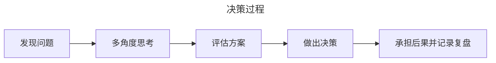

## 克服一个本能，从得分手变身助攻者

### 摆脱自满心态、看见自己的弱点

### 选择谦卑，敢于说出“我不行，我需要帮助”

### 从为了回报转向为了责任

> 体检表

- [ ] 当他人提出不同意见，第一反应是解释而非倾听
- [ ] 近三个月没有主动寻求外部建议
- [ ] 我认为，证明自己正确比解决问题更重要
- [ ] 我当日程表“学习反思”时间占比低于10%
- [ ] 听到下属说“你说的对”时，我会感到愉悦

> 助攻时刻

- 时常问自己三个关键问题：我近期最该停止的行为是什么？请对方用邮件回复，确保自己可以进行书面反思
- 勇敢地说出“我不行，我需要帮助”
- 尽一切努力做一个以责任为中心的责任型领导者

## 认清两大职责，位置决定行动

- 亲力亲为，亲自动手撰写方案、攻克技术难题、像团队里最优秀的专家一样产出成果
- 团队赋能者，通过决策、协调和辅导，为团队扫清障碍，让成员们能够更好地完成各自的任务

### 关键职责1: 决策并承担决策后果

> 能不能是基础（能力），敢不敢是勇气，愿不愿意是动机

### 关键职责2: 协调关系、协调资源

协调关系的目标：通过角色施加影响，把所有可能的对抗关系转换为同盟关系。

> 体检表

- [ ] 我从没有主动去深入了解过1号位这个角色的职责和要求
- [ ] 遇到问题时，我很少会先思考，而是直接行动
- [ ] 在决策时，我总是犹豫不决，不敢承担决策的责任
- [ ] 在协调团队关系和资源时，我经常采取直接问责或公开对质的方式
- [ ] 面对团队成员的反对意见，我很难保持客观、冷静，容易产生抵触情绪

> 助攻时刻

- 主动询问一名直接下属：我是谁？我该做什么？我该怎么做
- 遇到问题先从不同角度思考这个问题，再做出决策，并记录决策过程
- 分清应当在何时为了哪个目标的实现进行资源的再分配

Ref from GPT

query: 公司职能部门1号位如果从不同角度思考问题，然后决策并记录决策过程？

AI：

决策框架

- 问题：
- 背景：
- 目标：
- 可选方案
- 关键事实
- 主要风险
- 我的判断
- 最终决策
- 为什么选择它
- 当时有哪些不确定性
- 预期结果
- 复盘日期

看问题的视角

- 公司视角：CEO希望部门怎么处理
- 部门视角：怎么保证部门长期有效
- 员工视角：决策者会遇到什么问题

反向视角

- 每次做重要决策前，问自己： 如果这个决策最终证明是错的，最可能错在哪里？
- 然后再问：如果我是反对这个决定的人，我会怎么攻击这个方案？
- 最后：有没有一个事实出现后，我会改变自己的决定？

## 苦练三项基本功，关注最重要的人和事

使用不同颜色的笔，在日程表做标记

- 红色：耗时最多的任务
- 蓝色：只有自己才能做、无法授权
- 绿色：真正实现双向深度交流沟通

**事**背后对于目标**管理和时间**管理

**人**则体现的是**沟通**管理。沟通本身不是目的，沟通要达成的后续行动结果才是。

### 目标管理，减少目标分解过程中的损耗

战略目标如何制定？ 愿景 -> 目标 -> 指标 -> 任务

### 时间管理，优先与目标相关的事

优先级管理：当下最重要的事情是什么

学会拒绝，和目标不相关的请求说“不”

长线意识，永远不要用忙碌替代思考

*有任务时知道怎么做、没任务时知道要做什么*

### 沟通管理，优先与目标相关的人

有效沟通三要素：认准沟通对象、明确沟通目的、用对沟通方式

|               | 命令指挥                                                               | 收集信息                           | 征询意见                                                         |
| ------------- | ---------------------------------------------------------------------- | ---------------------------------- | ---------------------------------------------------------------- |
| 1号位作为上级 | 简单直接，清晰明确地宣布，告诉团队你的决定                             | What, When, Who, Where, and How    | 倾听                                                             |
| 1号位作为下属 | 领受任务。问：何时启动、谁参与，资源支持如何、成功标准是什么，潜在障碍 | 汇报工作 金字塔原理、STAR原则 | 提出建议。 说出自己的洞察和见解 应聚焦在“如何做”层面 |

> 体检表

- [ ] 在制定目标时，我往往只是简单地将上级的目标分解
- [ ] 与下属沟通时，我经常用商量的口吻下达命令
- [ ] 在工作中，我更注重当下的目标，而忽视了最初的目标
- [ ] 我每天的时间常常被紧急但不重要的事务占据
- [ ] 我掌握了很多沟通技巧，但没有什么沟通意愿

> 助攻时刻

- 梳理自己负责的工作目标，将大目标分解为具体的任务和行动步骤，并确定优先级
- 制定一天的工作计划，明确每个任务的开始和结束时间，确保优先去处理重要且紧急的任务
- 在与团队成员沟通时，注意使用清晰、简洁的语言表达自己的观点，并在对话结束后，花5分钟时间反思沟通的效果。

> 表达观点的tips:
> 先说结论，再说依据；先说重要的，再说次要的。
> 模版：观点，2～3个理由，建议

思考框架，怎么想

决策框架，我怎么选

表达框架，我怎么让别人理解我的选择

	- 结论 -> 依据 -> 风险 -> 选择 -> 行动

	- 示例： 我理解你的观点；我们可能关注的是不同的问题；你关注的是短期交付，我更关注长期维护成本；如果我们把长期维护成本也考虑进去，我还是倾向于方案B。

行动框架，怎么让组织执行

## 对抗四大惯性，小改变产生大影响

### 多巴胺惯性，让人急于进入行动状态

快起来是本能、慢下来是本领

紧急会议、关键谈话、重要决策前先深呼吸3次，摆脱多巴胺惯性

### 基本归因错误的惯性，引起误解和猜忌

基本归因错误：自己成功内因，自己失败外因；别人成功外因，别人失败内因

破解：训练自己不解释的能力，直接宣布结论。如果下属有疑问，先听下属如何理解，为什么有些地方他们不能接受，听完后再给出的解释和回应更容易被下属接受。**只做决策，不做解释**

破解2: 需要团队的帮助

### 情绪化惯性，失去理性思考的能力

情绪：客观存在的心理状态

情绪化：丢失了对情绪的主导权，让情绪完全占据大脑、控制言行

sample：一定要表达愤怒（内容），而不是愤怒地表达（形式）

### 复杂偏见的惯性、忽视简单坚持的力量

需要解决的问题是复杂的，面临的问题局面是复杂的，但是解决任何一个复杂问题都必须从简单的动作开始。在具体行动上，这个行动本身必须是简单的

> 体检表

- [ ] 紧急会议中，习惯性地打断对方发言
- [ ] 将团队失误归咎于外部环境或成员能力
- [ ] 情绪激动时 ，提高音量或言辞激烈
- [ ] 倾向于采用复杂方案而非简单方法
- [ ] 决策前从不做深呼吸等缓冲动作

> 助攻时刻

- 会议前做3次缓慢吐气，深呼吸
- 破除基本归因错误：记录一个新出现的场景/动作，主动承认自身责任
- 情绪选择训练：在情绪波动时自问“此刻最适合达到目标的情绪是什么”
- 简化复杂性：将今日的某个复杂任务拆解位3个基础动作执行
- 建立“血清素时刻”：下班前静坐10分钟，复盘今日的“组织健康”行为

## 驾驭年龄变化，突破职业瓶颈

### 27，感知权力（业务、财务、人事）

不敢使用权力

滥用权力

### 37，服务团队

团队第一负责人

开有效的会

管理下属

日常点滴中建立组织的文化

### 57，传承文化

接班人

> 体检表

- [ ] 不清楚自己当前年龄阶段的核心课题
- [ ] 在权力的使用上存在不敢或滥用的情况
- [ ] 更依赖个人能力，而非团队协作
- [ ] 没有意识到需要培养接班人或思考组织传承的问题
- [ ] 因年龄而回避应承担的决策或协调职责

> 助攻时刻

- 反思并写下自己当前年龄阶段最需突破的一个课题
- 检查自己最近3次权力使用的情况。不敢或滥用
- 主动向一位团队成员询问他对你领导力的真实意见
- 建立或更新一份接班人培养计划或组织传承思考笔记
- 在今日决策中，不要急于行动，可以练习慢下来思考
