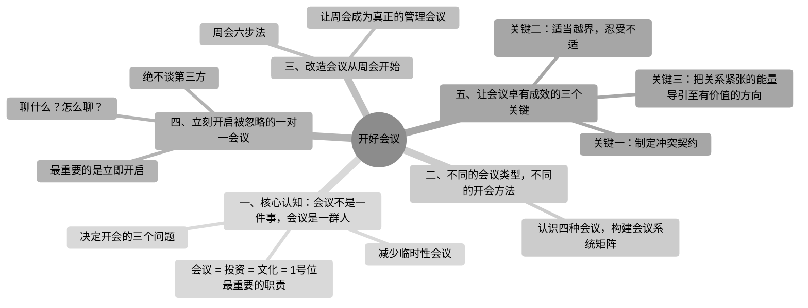

# 第三部分：开好会议

## 本部分内容地图

```
开好会议
├── 一、核心认知：会议不是一件事，会议是一群人
│   ├── 会议 = 投资 / 文化 / 1号位最重要的职责
│   ├── 决定开会的三个问题
│   └── 减少临时性会议
├── 二、不同的会议类型，不同的开会方法
│   └── 四种会议系统矩阵（1v1 / 团建 / 周会 / 专题）
├── 三、改造会议从周会开始
│   └── 周会六步法
├── 四、立刻开启被忽略的一对一会议
│   ├── 聊什么 / 怎么聊
│   ├── 立即开启与频率
│   └── 绝不谈第三方
└── 五、让会议卓有成效的三个关键
    ├── 关键一：制定冲突契约
    ├── 关键二：适当越界，忍受不适
    └── 关键三：把关系紧张的能量导引至有价值的方向
```

## 一、核心认知：会议不是一件事，会议是一群人

### 1.1 被会议搞崩溃的 1 号位

- 只改变会议，一切会回到原点。
- 真正需要改变的不是会议，而是人。**人不变，会议不变。**

### 1.2 会议 = 投资 = 文化 = 1 号位最重要的职责

**（1）会议 = 投资**

- 用会议时间计算 ROI。

**（2）会议 = 文化**

- 到公司各处走走，去几个不显眼但很重要的地方观察细节：卫生间、白板、食堂。
- 旁听领导团队的会议。

**（3）会议 = 1 号位最重要的职责**

- 会议是 1 号位的本职工作。

### 1.3 决定开会的三个问题

1. 是否有明确且值得开会的核心目标？
2. 目前的参与者是否都有助于目标的达成？
3. 是否有其他更高效的沟通工具可以达成此目标？

### 1.4 减少临时性会议

- （方法待补充）

> **体检表**
>
> - [ ] 我没有计算过一场会议的真实成本
> - [ ] 我很少思考这个会议是否真的需要开
> - [ ] 我时常召开临时性会议
> - [ ] 我认为会议效率低是流程问题，与人无关
> - [ ] 我认为会议文化是软性的，不如业绩重要

> **助攻时刻**
>
> - 在今日会议 PPT 首页标注："本场会议成本：¥_____"
> - 为每个议题标注预期的投资回报率
> - 用 3 个问题审视明天的一场会议：是否有明确且值得开会的核心目标？
> - 在自己每天都能看到的地方写下："会议不是一件事，会议是一群人。我要为这群人的时间负责。"

---

## 二、不同的会议类型，不同的开会方法

### 2.1 认识四种会议，构建会议系统矩阵

**三个划分维度：**

| 维度   | 取值          |
| ------ | ------------- |
| 维度一 | 人 / 事       |
| 维度二 | 简单 / 复杂   |
| 维度三 | 定期 / 不定期 |

**四种会议类型：**

| 类型               | 组合 | 会议形式   |
| ------------------ | ---- | ---------- |
| 人 + 简单 + 定期   | —   | 1v1        |
| 人 + 复杂 + 不定期 | —   | 团建会议   |
| 事 + 简单 + 定期   | —   | 周管理会议 |
| 事 + 复杂 + 不定期 | —   | 专题会议   |

> **体检表**
>
> - [ ] 我习惯把所有问题都塞进一个会议里讨论
> - [ ] 上周我未召开任何一对一的会议
> - [ ] 我参加的专题会议常常演变成即时决策会议
> - [ ] 我很少区分战术议题和战略议题
> - [ ] 我的团队建设就是吃喝玩乐的活动

> **助攻时刻**
>
> - 分析已经发生的会议日历，尝试贴上会议类型的标签
> - 红笔圈出明日会议中的战略议题
> - 与下属进行 1 对 1 沟通
> - 将未决议题移入共享文档，标注"专题待议"

---

## 三、改造会议从周会开始

- 周会划分 5 个维度：**重要性、复杂性、紧迫性、明确性、一致性**
- 周会目标：**对齐信息、解决问题、做出决策**

### 第一步：60 秒闪电汇报，收集个人重要议题

- 每人提出最关注的两三个问题 / 事项，列示核心词。
- 用时小于 60 秒。
- **不讨论、不分解、不解释。**

### 第二步："红绿灯"快速检视，识别集体重要议题

- 回顾团队目标进展。
- 红：警告；黄：正常；绿：健康。
- 重点关注红灯。

### 第三步：15 分钟标尺，判断议题的复杂性

- 分清战略议题和战术议题。
- 判断标准：15 分钟内讨论不完的议题，即视为复杂 / 战略议题。

### 第四步：敲定今日议题，将议题按紧迫性排序

- 首先处理战术议题（紧迫性高）。
- 其次处理战略议题（紧迫性低）。
- 完整逻辑：周会优先解决紧迫的战术议题；复杂 / 战略议题放入"战略停车场"，留待专题会议。

### 第五步：解决今日议题，追求明确的结论

- 着手解决那三四个战术议题，力求得出明确结论。

### 第六步：回顾会议纪要，确保一致性

会议纪要四要素：

| 要素                         | 说明                                         |
| ---------------------------- | -------------------------------------------- |
| **今日议题**           | 本次会议讨论了什么议题                       |
| **会议决定**           | 明确团队的最终决定，谁在什么时候完成什么事情 |
| **保密约定**           | 团队最容易忽略的                             |
| **需传递和沟通的事项** | 不仅仅是宣读结论，更重要的是双向沟通         |

**保密范围**：私人信息、冲突场景、悬而未决的事项、团队成员认为需要保密的内容。

### 让周会成为真正的管理会议

- 管理目标
- 管理时间
- 管理决策

> **体检表**
>
> - [ ] 我的周会一般是 3～4 小时
> - [ ] 我的周会议程总是提前确定，不再更改
> - [ ] 周会上，议题讨论常常超时且无叫停机制
> - [ ] 会议纪要中未明确"行动—责任—时限"等信息
> - [ ] 会议纪要很少强调保密约定

> **助攻时刻**
>
> - 周会试行 60 秒闪电汇报：两三个议题，不讨论，不分解，不解释
> - 明确规定 15 分钟讨论不完的议题进入"战略停车场"
> - 会议纪要覆盖四个方面：今日议题、会议决定、保密约定、需传递和沟通的事项
> - 会议纪要首页添加"本会议内容禁止外传"水印

---

## 四、立刻开启被忽略的一对一会议

### 4.1 一对一会议，组织里回报率最高的投资活动

- 既是 1 号位的本职工作，也是对下属的投资行为。

### 4.2 聊什么？怎么聊？

**聊什么？**

- 请下属列一个想讨论的话题清单，可关于工作、生活、短期问题、长期职业生涯。

**怎么聊？**

- 1 号位听对方说话的时间，多于自己讲话的时间。
- **聽**：会听者，才是王；十目一心。沟通过程中，注意力放在对方身上。

**常用话术：**

- "我听到的是……"
- "所以你的意思是……"
- "关于 XX 的事情，我需要你的帮助，可以听听你的看法吗？"
- "我想成为更好的领导者，你可以给我一些反馈吗？"

### 4.3 最重要的是立即开启

**频率建议：** 不建议低于两周。

| 频率     | 时长        |
| -------- | ----------- |
| 一周一次 | 25～30 分钟 |
| 两周一次 | 45～60 分钟 |

### 4.4 绝不谈第三方

- 下属抱怨某个人，1 号位要学会不接茬。
- 原因：无论接什么话，即使出于好意，只要下属离开办公室之后把话传出去，信息都会变形，产生歧义，哪怕他是无意的。
- 1v1 沟通，特别注意**绝对不谈第三方**。

> **体检表**
>
> - [ ] 我与下属的沟通大多是临时、随机、被动响应的
> - [ ] 我认为一对一会议是额外工作，挤占了我的工作时间
> - [ ] 在一对一会议中，通常是我说得多，下属说得少
> - [ ] 我会在一对一会议中谈论其他同事的问题
> - [ ] 我很少在一对一会议中问下属是否有工作以外的困扰

> **助攻时刻**
>
> - 为你和每个直接下属预定未来一个季度的一对一会议，并设为重复事件
> - 下次一对一会议前 10 分钟只听不说
> - 问下属：本周你最想和我讨论什么？
> - 与下属分享一个自己近期工作中的困扰
> - 严肃地告诫自己：一对一会议中绝对不谈任何第三方

---

## 五、让会议卓有成效的三个关键

### 引入案例：拂袖而去的董事长

### 关键一：制定冲突契约

冲突契约示例：

- 沉默等于不同意。
- 发言超过两分钟，他人就可以打断。
- 有问题就直说，别绕弯子。
- 如果你觉得大家是在浪费时间，立即提出。
- 别瞎猜，也别假设别人的想法，去问清楚。
- 有话当面讲，不在背后议论。
- 摘掉自己头上的部门"帽子"再参与讨论。

### 关键二：适当越界，忍受不适

- 冲突发生时一定夹杂着情绪。
- 1 号位在冲突中需要扮演两个角色：

**（1）冲突的挖掘者**

- **没事找事**：问题背后可能存在更大的问题；原因背后通常有更重要的原因；答案背后还有更好的答案。
- **煽风点火**：使用打断、肯定，以及鼓励继续。

**（2）冲突的参与者**

- 既是运筹帷幄的教练，又是冲锋陷阵的球员。

### 关键三：把关系紧张的能量导引至有价值的方向

- （方法待补充）

> **体检表**
>
> - [ ] 我的会议上很少出现激烈的观点交锋的情况
> - [ ] 我曾用"会后再说"推迟关键争论
> - [ ] 我认为"冲突 = 人际关系破坏"
> - [ ] 我们团队没有制定"冲突契约"
> - [ ] 我认为情绪应该被隔离在会议室外

> **助攻时刻**
>
> - 团队提前约定"可随时打断发言"或"沉默等于不同意"
> - 当你感觉到一个议题被轻轻带过时，尝试问："我们是否在回避一个棘手的问题？"
> - 当会议上出现意见分歧时主动介入并予以肯定

---

## 思维导图



---
