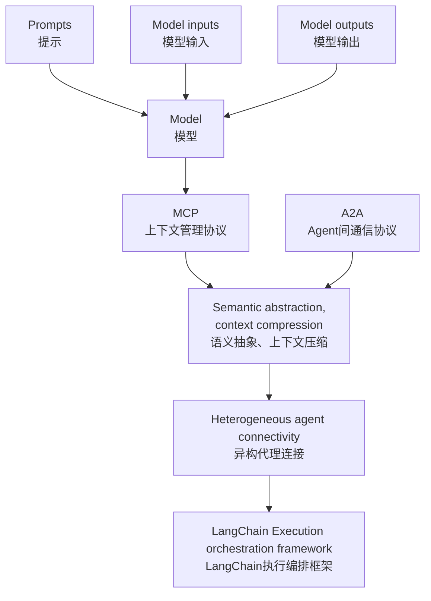
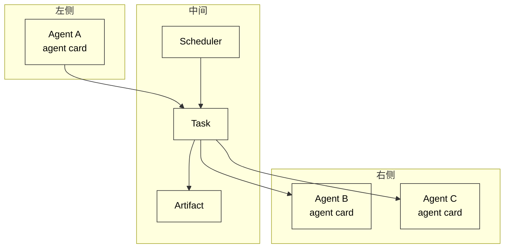

## 大模型系统架构中的协议与调度基础

### 多Agent系统演进趋势

模型上下文： converstaion history + user input + model output

#### 瓶颈：

1. 多轮对话语义膨胀
2. 信息密度分布不均
3. 上下文压缩机制缺失

#### Agent间的协同结构演化

1. 松耦合任务编排结构的兴起
2. 引入语义协同与上下文共享机制
3. 协议化协同结构；MCP实现上下文语义标准化、A2A实现任务的格式封装与通信同步

#### 传统Prompt限制

1. 缺乏任务链条结构表达能力
2. 上下文组织与动态注入能力薄弱
3. 缺乏语义可组合性与协议协同能力

#### 通信与上下文管理能力

1. MCP核心目标：实现模型调用与Agent交互中的上下文语义统一
2. A2A协议为多agent间的任务调度、状态追踪与能力发现提供统一协议
3. 协议却动结构的协同作用

### 多协议生态对比：MCP、A2A、langchain

#### 基于协议分层的系统集成结构



#### LangChain做为编排框架的作用

#### MCP协议的语义抽象与上下文压缩

1. Slot机制；内容、来源、标识与元数据的独立语义单元
2. 语义抽象与结构化压缩；embedding聚类压缩、生成式摘要压缩、与语义权重裁剪
3. 语义连续性与跨任务共享



#### A2A协议的异构Agent连接机制

### 多Agent开发典型场景与构建逻辑

#### 多轮对话的上下文共享

#### 任务拆分与Agent能力声明

#### 工具增强与插件注入

#### 文档、数据库与Agent

### 协议驱动的Agent系统设计原则

#### 语义完整性与状态持久性

上下文压缩与语义确实的风险控制

状态持久性的定义与实现路径

多Agent系统中的语义状态同步机制

#### 可重入性与任务断点恢复机制

#### Agent的自治性与可组合性

#### 通信安全、身份认证与访问机制

## MCP协议详解

### MCP设计理念与核心目标

#### MCP 协议详解

1. slot, 上下文最小语义单元

```Python
class Slot:
  def __init__(self, content, role, metadata:dict):
  	self.slot_id=str(uuid.uuid4())
    self.conent = content
	self.role = role
	self.timestamp = time.time()
  

  def to_dict(self):
    pass
```

1. contextchaiai, slot链路结构

```Python
class ContextChain：
	def __init__(self):
      self.slots=[]

	def add(self, slot: Slot):
      self.slots.append(slot)

    def as_prompt(self):
      return "\n".join([f"{s.role.upper()}: {s.content}" for s in self.slots])
```

1. inject与injectChian

```Python
def inject(context: list[str], slot: Slot) -> list[str]:
	context.append(f"{slot.role.upper()}: {slot.content}")

def injectChian(context: list[str], slots:list[Slot]) -> list[str]:
  	for s in slots:
      context.append(f"{s.role.upper()}: {s.content}")
	return context
```

1. compress

```Python
def compress(slots) -> Slot:
  text = ";".join(s.content for s in slots)
  return Slot(f"compressed: {text}", role="summary")
```

1. semanticGroup

```Python
class SemanticGroup:
  def __init__(self, topic:str):
    self.topic = topic
    self.slots = []
  
  def add(self, slot:Slot):
    self.slots.append(slot)

  def summarize(self):
    merged = ",".join([s.content for s in self.slots])
    return Slot(f"[{self.topic}] summary: {merged}", role="summary")
```

1. resolve

```Python
def resolve(chain: list[Slot], required_keywords: list[str]) -> list[slot]
	result = []
  	for slot in chain:
      if any(k in slot.content for k in required_keywords):
        result.append(slot)
    return result
```

1. executionContext

```Python
class ExecutionContext:
  def __init__(self, task_id， context_chain: ContextChian):
    self.task_id = task_id
    self.context_chain = context_chain
    self.created_at = time.time()

  def get_prompt(self):
    return self.context_chain.as_prompt()
```

总表

| modue              | desc                                                   |
| ------------------ | ------------------------------------------------------ |
| Clot               | 语义片段基本单元                                       |
| ContextChain       | 管理slot链结构，构造对话窗口与上下文流程               |
| inject/injectChain | 控制slot或slot序列的注入逻辑，构建prompt               |
| compress           | 多slot合并压缩，生成摘要slot                           |
| semanticGroup      | 结构化slot组织，提高语义模块聚合性                     |
| resolve            | 恢复缺失slot或结构信息，保障语义链完整                 |
| ExecutionContext   | 管理任务运行快照与上下文流，用于持久化与重构任务上下文 |

#### MCP Python SDK

服务端

```Python
from mcp.server.fastmcp import FastMCP, Context

mcp = FastMCP("HelloWorld")

@mcp.tool()
def add(a:int, b:int)->int:
  return a+b

@mcp.resource("config://app")
  return "app config here"

@mcp.resource("greeting://{name}")
def greeting(name:str)->str:
  return f"hello, {name}"

@mcp.prompt()
def review_code(code:str)->str:
  return f"please review this code: \n\n{code}"

@mcp.tool()
async def long_task(files:list[str], ctx: Context) -> str:
  for i, file in enumerate(files):
    ctx.info(f"processing {file}")
    await ctx.report_progress(i, len(files))
    data, mime_type = await ctx.read_resource(f"file://{file}")
  return "processing complete"
```

数据源 @mcp.resource, 支持静态与动态资源访问

工具 @mcp.tool, 支持同步与异步

提示词 @mcp.prompt

上下文， Context

开发模式，mcp dev server.py

部署， mcp insatll server.py --name "xxx"

直接运行，mcp.run()

SQLite MCP示例

```Python
import sqlite3
from mcp.server.fastmcp import FastMCP

mcp = FastMCP("SQLite Demo")

@mcp.resource("schema://main")
def get_schema()->str:
  conn = sqlite3.connect("sample.db")
  schme = conn.execute("select sql from sqlite_master where type='table'").fetchall()
  return "\n".join(sql[0] for sql in schema if sql[0])

@mcp.tool()
def query(sql:str)->str:
  conn = sqlite3.connect("sample.db")
  try:
    result = conn.execute(sql).fetchall()
    return "\n".join(str(row) for row in result)
  except Exception as e:
    return f"Error:{str(e)}"
```

### Slot机制：上下文基本语义单元

1. slot核心字段：slot_id, content, role, metadata
2. 抽象层级. 分类:user, agent, system, tool, knowledge; 层级: slot->slot group->context chain or execution context
3. prompt压缩与检索增强

### 上下文联络管理与ContextChain逻辑

## A2A协议详解

### 设计目标与接口体系

#### 目标：

通过AgentCard机制，每个Agent以标准结构向外声明自身能力，包括可调用的方法、输入输出规范，接口格式等，使得上游调度模块能够自动解析其可用性与调用方式

#### 协议详解

1. agent card; agent身份、功能方法、参数规范和输出格式

```JSON
{
  "id":"",
  "name":"",
  "description":"",
  "methods":[
    "method_name":{
      "description":"",
      "input_spec":{"type":"object", "properties":{"text":{"type":"string"}}, "required":["text"]},
      "output_sepc":{"type":"string"}
    }
  ]
}
```

1. task结构体

```JSON
{
  "task_id":"",
  "method":"",
  "input":{"text":"this is a patameter value"},
  "status":"pending",
  "created_at":""
}
```

1. agent任务执行 agent_exexute

```JSON
{
  "task_id":"",
  "status":"completed",
  "output":"this is a sample response"
}
```

1. 回调机制

```JSON
{
  "jsonrpc":"2.0",
  "method":"",
  "params":{"text":""},
  "id":""
}
```

## LangChain框架基础与组件解析

### 4.1 架构理念

#### 角色

1. 语义协调, prompt template, memory
2. 调用编排, chian与agent完成函数调用链路
3. 协议适配, 适配mcp与A2A

#### 为什么

1. langchain-core, 提供了统一的语言表达协议，支持链式任务的并行化、流失处理、异步等执行模式，并实现了Fallback、Tracing、Batching与Compositionality
2. langchain-community, 定义了与大模型集成所需的关键工具组件，主要划分为model io, retrieval与agent tooling三类
3. langchain主模块，认知架构层，整个系统的中枢调度器。抽象了三类高阶执行单元: Chains, Agents与Retrieval Stategies
4. Templates, 应用参考模板
5. LangServe， 构建好的chain或agent作为标准化rest api对外暴露
6. LangSmith，可观测平台

### 4.2 Core模块

### 4.3 工具集成与Funcation Call

### 4.4 Agent与Router设计
